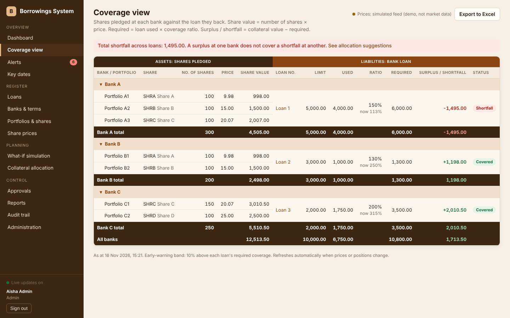

# Borrowings System

Tracks bank loans secured by pledged public equities: one register of loans, each bank's collateral
terms, live share values, and the surplus or shortfall of collateral on every loan.

## What it does

| Requirement | Where |
|---|---|
| Loan register: limit, used, dates, rate, repayments | Loans, loan page (drawdowns and repayments keep a running balance) |
| Loan documents with version history and expiry reminders | Loan page, Documents tab (stored encrypted) |
| Bank terms: coverage ratio, top-up and margin call levels, eligible shares | Banks & terms (per bank), with per-loan overrides on the loan |
| Terms apply automatically to coverage | Coverage engine, `server/src/engine/coverage.ts` |
| Prices, automatic re-valuation, price history | Share prices; live refresh on every screen |
| Shares per bank and portfolio, surplus / shortfall per loan and in total, drill-down | Coverage view, Dashboard |
| Coverage alerts with email / SMS | Alerts (early warning band, shortfall, top-up, margin call) |
| What-if simulation | What-if simulation (all shares or per share) |
| Collateral allocation | Collateral allocation (suggests moves, never puts a donor loan at risk) |
| Dashboards, Excel / PDF exports, bank statements | Dashboard, Reports |
| Roles, approval workflow, full change log | Approvals, Audit trail, Administration |
| APIs for accounting, treasury, custody | `/api/v1` with scoped API keys; spec at `/api/v1/openapi.json` |
| Finance charge dates and alerts | Loan page, Finance charges tab; Key dates |
| Maturity, review and renewal reminders | Key dates, Alerts |

The calculation is the one in the requirements deck:

    share value        = number of shares x price
    coverage required  = loan used x coverage ratio
    surplus/shortfall  = collateral value - coverage required

Collateral value counts only shares the bank accepts, after any haircut. The demo data reproduces the deck:
Bank A Loan 1 is short by 1,500; Bank B is +1,200; Bank C is +2,000.

## Run it

Needs Node 20+ and PostgreSQL 14+.

    cp .env.example .env          # set DATABASE_URL and APP_ENCRYPTION_KEY (openssl rand -base64 32)
    npm install
    npm run build
    npm run seed                  # optional demo data; refuses to run in production
    npm start                     # http://localhost:4000

For local use over plain http set `NODE_ENV=development` and `COOKIE_SECURE=false` in `.env`.
Development with hot reload: `npm run dev` (web on :5173, API on :4000).

Demo sign-ins (password `Treasury-Demo-2026`): `admin@demo.local`, `manager@demo.local`,
`officer@demo.local`, `auditor@demo.local`.

A `Dockerfile` and `docker-compose.yml` are included as a starting point. They have not been run in the
environment this was built in; test them before relying on them.

## Roles

| Role | Can do |
|---|---|
| Officer | Enter loans, transactions, pledges, prices, documents. Changes to loans, terms and positions wait for approval. |
| Manager | Everything an officer can, plus approve or reject other people's requests, and read the audit trail. |
| Administrator | Everything, plus users, API keys and settings. |
| Auditor | Read-only, including the audit trail. |

Nobody can approve their own request. The approver's action re-validates the change against current data.

## Security

- Passwords: Argon2id; 12+ characters; lockout after 5 failures for 15 minutes; temporary passwords must be replaced at first sign-in.
- Two-step verification (authenticator app, TOTP). Secrets are encrypted at rest.
- Sessions: random token in an `HttpOnly`, `SameSite=Strict`, `Secure` cookie; only its hash is stored. 30-minute idle
  timeout that background refreshes do not extend, 12-hour absolute limit, sign-out revokes server-side.
- CSRF token required on every state-changing request. Strict Content-Security-Policy, HSTS, no caching of API data.
- Every query is parameterised. Every input is validated on the server. Amounts are exact decimals end to end (`NUMERIC` and decimal.js), never floats.
- Documents: type allow-list checked against file content, encrypted on disk (AES-256-GCM), integrity-checked on download.
- Audit trail: every change, sign-in, approval, export and download; before and after values; hash-chained; the
  database rejects UPDATE, DELETE and TRUNCATE on it. "Verify integrity" recomputes the chain.
- API keys: shown once, stored hashed, scoped (`read`, `prices:write`), revocable.
- Rate limiting on all routes, tighter on sign-in.

### Before going live

1. Serve over HTTPS behind a reverse proxy; set `COOKIE_SECURE=true`, `TRUST_PROXY=true`.
2. Do not seed. Create the first administrator directly, then have every user turn on two-step verification.
3. Run the app with a database role that does **not** own the tables (grant it SELECT/INSERT/UPDATE/DELETE, and only
   SELECT/INSERT on `audit_log`). The owner role can disable the audit trigger; the hash chain would reveal the
   tampering, but it is better that the app cannot do it at all.
4. Back up the database, the document folder and `APP_ENCRYPTION_KEY` (without the key, documents cannot be read).
5. Connect the price feed, SMTP and SMS gateway (below).
6. Commission an independent penetration test. This code has automated tests and was written defensively; it has not been externally audited.

## Prices

`PRICE_PROVIDER=manual` (default): prices are typed in, or pushed by a market-data, treasury or custody system:

    curl -X POST https://host/api/v1/prices -H "Authorization: Bearer bsk_..." -H "Content-Type: application/json" \
      -d '{"source":"tadawul","quotes":[{"symbol":"2222","price":"27.85"}]}'

`PRICE_PROVIDER=simulated` moves prices randomly for demonstrations. The screens label it clearly. It is not market data.

A direct connection to a licensed feed is a small adapter: implement `PriceProvider` in `server/src/services/prices.ts`.
None is bundled, because it depends on which vendor contract you hold.

## Alerts by email and SMS

Alerts always appear in the app. To deliver them, set `SMTP_URL` (email) and `SMS_WEBHOOK_URL` (any SMS gateway that
accepts a JSON POST of `{to, body}`). Until then the notification log shows them as "skipped", not "sent". Each user
chooses email and SMS in My account.

## Tests

    npm test          # coverage and allocation engine against the deck's figures
    npm run e2e       # 37 browser tests in Chromium (needs .env.test pointing at a disposable database whose name contains "test")
    npm run check     # typecheck + unit + build + e2e

`.env.test` is `.env` with a test `DATABASE_URL`, a different `PORT`, `PRICE_PROVIDER=manual`,
`UPLOAD_DIR=./storage/test-documents`, and raised `RATE_LIMIT_PER_MINUTE` / `LOGIN_RATE_PER_MINUTE`.
If Chromium is not installed: `npx playwright install chromium`.

## Layout

    server/src/engine      pure calculation (coverage, allocation), no I/O
    server/src/services    commands + approvals, alerts, prices, notifications, reports
    server/src/routes      HTTP API
    server/src/security    passwords, sessions, permissions, encryption
    server/src/migrations  database schema
    web/src                React app
    e2e                    browser tests

## Known limits

- One currency (SAR) and one company. No multi-entity or FX.
- The demo data stores the deck's figures literally (the deck labels them SAR'000).
- Rate limiting is in-memory, so it is per server process. Run one instance, or move it to a shared store before scaling out.
- Rates are recorded on the loan; finance charges are entered or scheduled, not computed from the rate.
